# Guardify

Per-app firewall and data tracker for Android. No root, no server, everything runs locally.
Built with Material 3, Jetpack Compose and Material You dynamic colors.

<!-- SCREENSHOTS:START -->
<p align="center">
  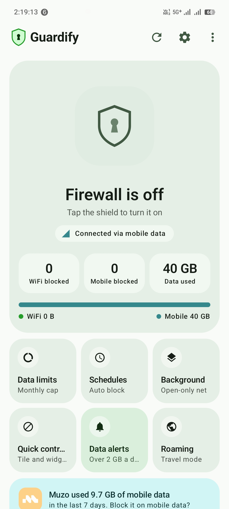
  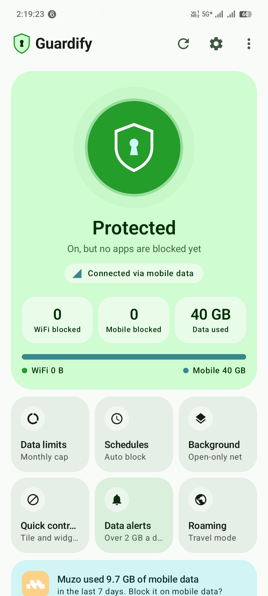
  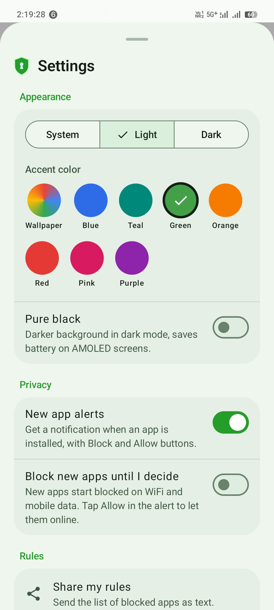
  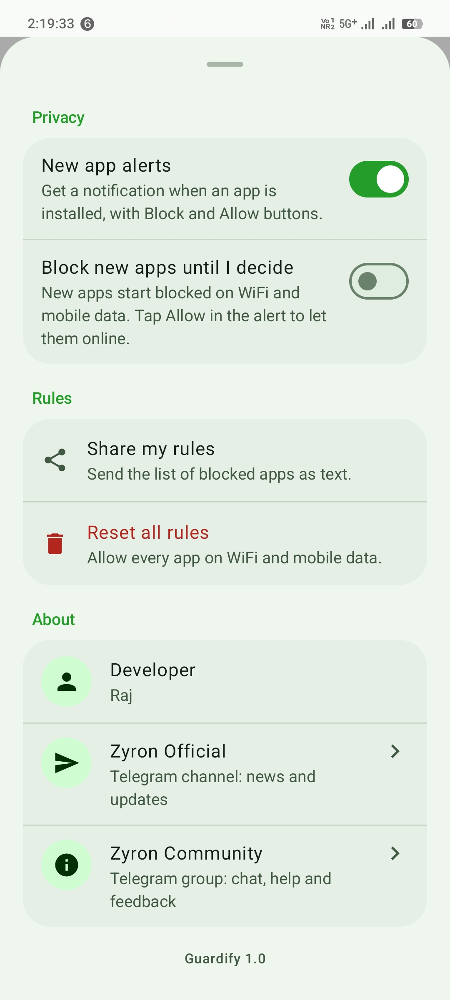
  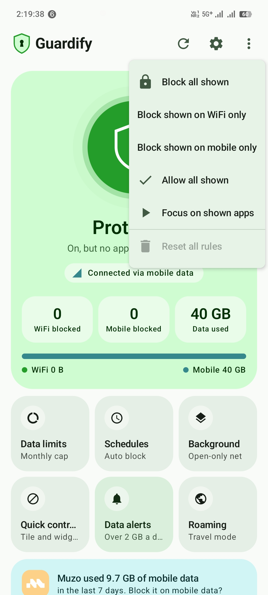
  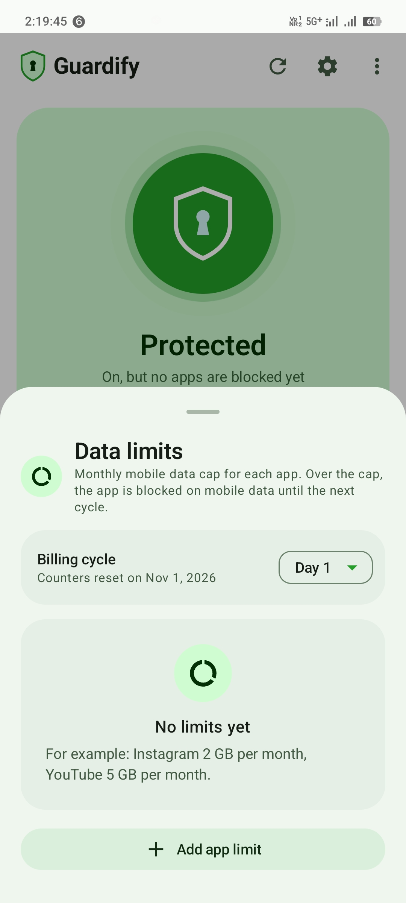
  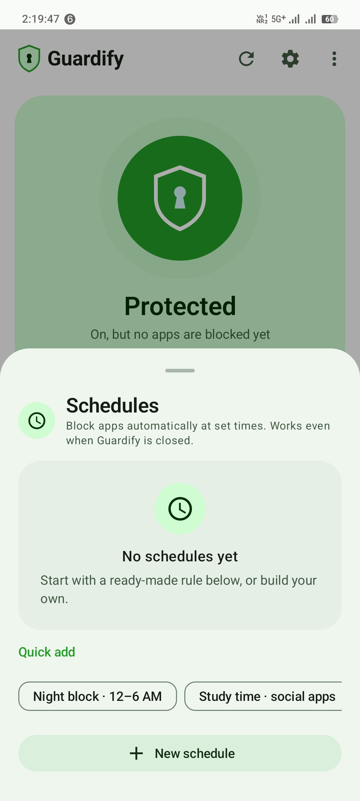
  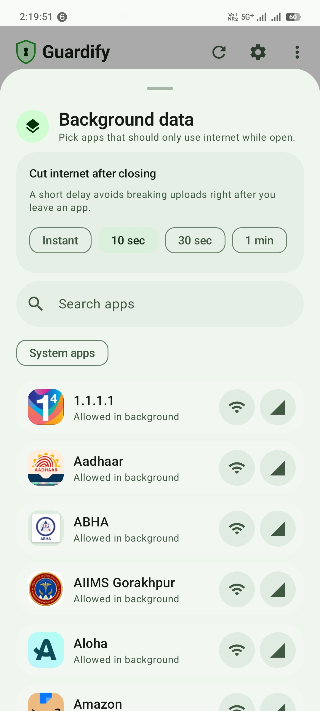
  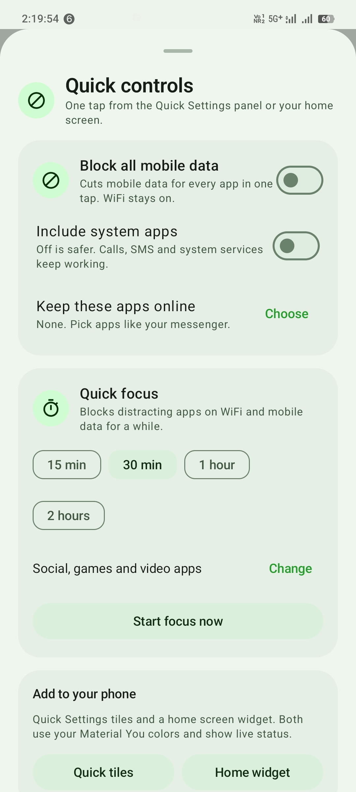
  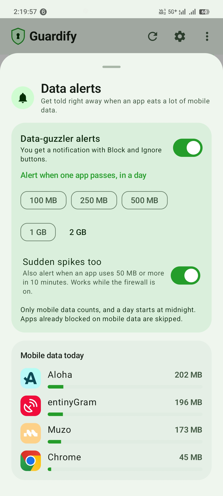
  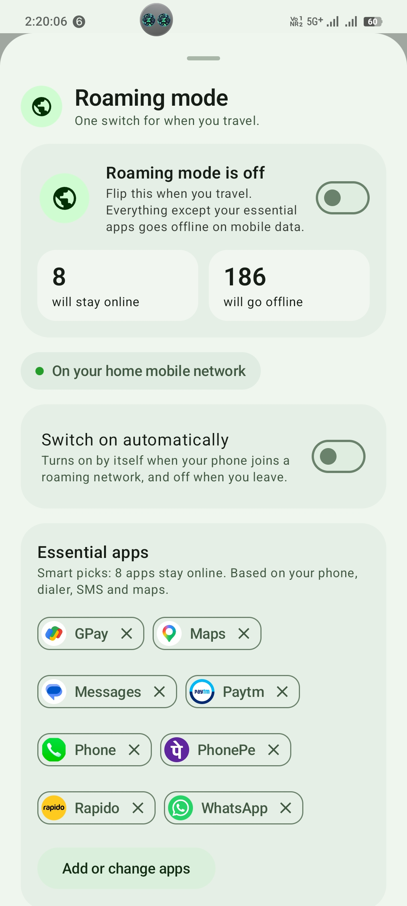
</p>
<!-- SCREENSHOTS:END -->

## Features

**Automation**
- **Data limits:** monthly mobile data cap for every app, with a billing cycle day you can set. When an app crosses its limit it is blocked on mobile data, and it unblocks itself in the next cycle.
- **Schedules:** time, days, network and apps (All, Category, or Pick apps). Rules that cross midnight work too (for example 11 PM to 6 AM). Ready-made presets: Night block and Study time.
- **Background data:** an app gets internet only while it is open. After you close it, internet is cut after a short grace delay. Needs Usage access permission.
- **Roaming mode:** one switch to give mobile data only to essential apps while you travel. WiFi is never touched. With "Auto" on, it turns on when your network starts roaming and turns off when you leave. If you pick no essential apps, Guardify suggests them from your phone (dialer, SMS, maps, WhatsApp, UPI, cab apps). Newly installed apps are blocked automatically.

**Quick controls and alerts**
- **Quick Settings tiles:** "Mobile data off" (block every app on mobile data in one tap) and "Focus". Long-press a tile to open the quick controls sheet.
- **Home screen widget** (Jetpack Glance, Material You colors): the same two buttons in a small (2x1) and a large (3x2) size.
- **Block all mobile data:** system apps stay out by default (change it with "Include system apps"), and "Keep these apps online" lets chosen apps through.
- **Quick focus:** blocks the apps you pick, or Social + Games + Video by default, for 15 minutes to 2 hours.
- **Data alerts:** a notification when an app crosses your limit today, or uses 50 MB or more within 10 minutes, with "Block mobile" and "Ignore today" actions.

All rules are enforced by the firewall service, even when the Guardify app is closed.

## Install

1. Download `Guardify-v1.0.apk` from the [latest release](https://github.com/bughunter11/Guardify/releases/latest).
2. Open it and allow "Install unknown apps" for your browser or file manager when Android asks.
3. Open Guardify and allow the VPN request. This is Android's local VPN API that the firewall uses.

**Requires Android 10 (API 29) or newer.**

The release APK is signed with the developer's own key. You can check that a download is genuine by comparing its SHA-256 with the value in the release notes.

## Permissions

| Permission | Why |
|---|---|
| VPN (`BIND_VPN_SERVICE`) | Local VPN used to allow or block each app. No traffic leaves your phone through it. |
| Usage access (`PACKAGE_USAGE_STATS`) | Detect which app is open, for the background data feature. |
| Notifications | Data alerts, roaming mode and new-app alerts. |
| Query all packages | List the installed apps so you can set rules for them. |
| Receive boot completed | Bring the firewall back after a reboot. |

## Privacy
- **No `INTERNET` permission.** The app cannot send your data anywhere. Everything stays on your phone.
- No accounts, no analytics, no ads.

## Support
If Guardify is useful to you, you can support the project from **Settings → About → Support** inside the app.

## Community
- Updates: https://t.me/Zyron_Official_26
- Help and feedback: https://t.me/Zyron_Community_26

## Build from source

```bash
git clone https://github.com/bughunter11/Guardify.git
cd Guardify
./gradlew assembleRelease
```

The APK is created at `app/build/outputs/apk/release/app-release.apk`.

Without a keystore the release build is signed with the debug key, which is fine for testing. To sign with your own key, create `keystore.properties` in the project root (never commit it, it is already in `.gitignore`):

```properties
storeFile=/path/to/your.jks
storePassword=...
keyAlias=...
keyPassword=...
```

On Termux you may also need an `android.aapt2FromMavenOverride` line in `gradle.properties`.

## Tech

Kotlin, Jetpack Compose, Material 3, Jetpack Glance, Android `VpnService`.

## License
[MIT](LICENSE)
